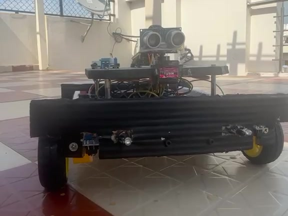
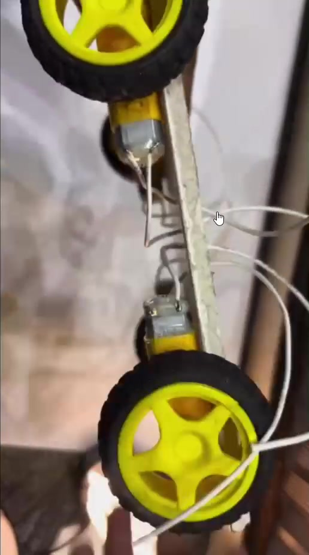
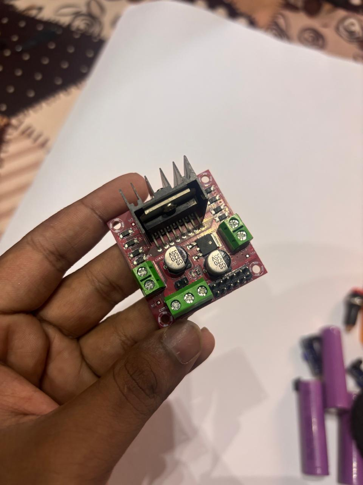
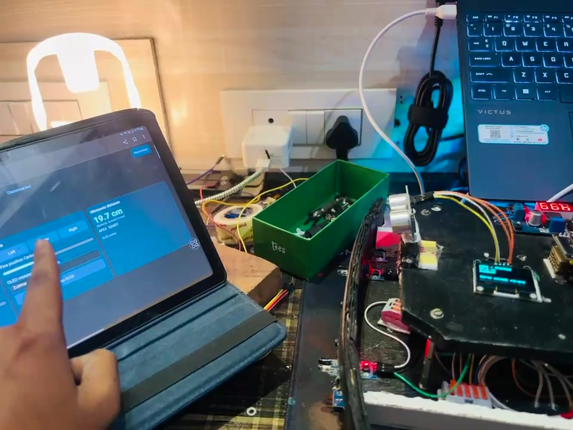
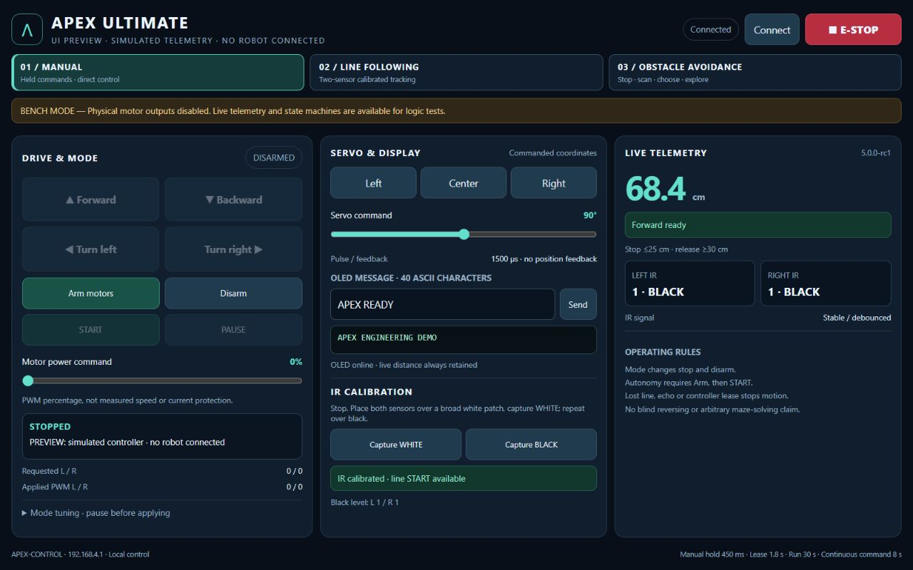

# APEX Ultimate

**An ESP32 robotics platform, built from first Blink to local Wi-Fi control.**

APEX combines a four-wheel chassis, a motor driver, a servo-mounted ultrasonic sensor and an OLED interface. I am building it to understand how mechanical assembly, electronics and embedded software become one controllable system—and to document the decisions and failures along the way.

**Current milestone:** earlier manual-build demonstrations are supplied; **V5 is a software-verified candidate**. Physical line-following and obstacle-avoidance validation remain pending.

<p align="center">
  
</p>

*The actual prototype, extracted from supplied terrace footage. This earlier-build image does not establish V5 autonomous performance.*

**[▶ Watch / download the 80-second engineering demonstration](https://github.com/Nihal786007/Apex/releases/download/v5.0.0-rc1/APEX_Engineering_Demonstration_2026.mp4)** · 1080p · caption-led with instrumental music · [V5 software-candidate prerelease](https://github.com/Nihal786007/Apex/releases/tag/v5.0.0-rc1)

The film distinguishes historical physical demonstrations from software tests and simulated UI footage. Physical V5 autonomous validation remains pending.

[Firmware](firmware/APEX_Ultimate_V5/APEX_Ultimate_V5.ino) · [Wiring and power](docs/POWER_AND_WIRING.md) · [Build and upload](docs/INSTALLATION.md) · [Test evidence](docs/BUILD_REPORT.md) · [80-second video storyboard](docs/DEMO_AND_RELEASE.md)

## The code behind the build

| Development stage | Inspect the actual source |
|---|---|
| First ESP32 experiment | [Original Blink sketch](progress/Session_01_ESP32_First_Blink/Blink.ino) and retained session notes |
| Earlier motor, servo, ultrasonic, OLED and Wi-Fi integration | [Preserved manual controller 1.0.1](reference/APEX_1_0_1_baseline.ino.txt), including Forward/Reverse, differential turns, PWM and held-button stopping |
| Before the direction correction | [Unchanged earlier controller](reference/APEX_before_direction_fix.ino.txt), with its original settings and limitations |
| Current three-mode candidate | [V5 sketch and required headers](firmware/APEX_Ultimate_V5): motor/sensor adapters, exact-testable mode logic and embedded browser dashboard |

The [source recovery and evidence guide](docs/SOURCE_AND_EVIDENCE.md) maps each subsystem to its actual functions, compares configurations, and connects source to footage only where supported. The earlier manual source matches the saved `APEX_Tablet.ino` byte for byte; **the exact firmware revision in the older movement videos is not verified**. Separate original motor-only, TB6612 and standalone sensor-test sketches were not recovered. Their absence is documented rather than filled with invented history.

Historical controllers are text archives for inspection: they lack the current BENCH gate and can energize outputs after Arm. The current four-file V5 remains the distributed candidate. Duplicate copies and later single-file personal exports stay outside this repository.

## What works—and what the evidence supports

| Capability | Available evidence | Status |
|---|---|---|
| Physical robot movement and tablet operation | Earlier floor footage and tablet-control recordings | Demonstrated in the earlier manual build; no measured speed or stopping-distance claim |
| OLED messages, servo pan and distance interface | Physical display and tablet/hardware sequences | Subsystem demonstrations supplied; absolute angle and ranging accuracy are not measured here |
| V5 manual control, line following and obstacle avoidance | Source code, exact-core tests, browser tests and ESP32 build | Software implemented and tested; not a completed physical acceptance test |
| Physical line following and obstacle-course navigation | No completed acceptance evidence supplied | **Pending** |

The [verification report](docs/BUILD_REPORT.md) records **232 passing core assertions** and a successful classic ESP32 build. These are software checks, including fixture assertions, rather than 232 independent hardware tests. Screenshots with simulated telemetry remain explicitly labeled.

## From components to integration

<p align="center">
  
  &nbsp;
  
</p>

*Chassis and motor installation, followed by the photographed motor-driver module. The construction still comes from an edited episode recording; the driver photograph is unchanged. [Original filenames, timestamps and provenance](docs/DEVELOPMENT_LOG.md#selected-media-provenance).*

The development record progresses from a Blink test through chassis assembly, component mounting, power and signal wiring, sensor/display experiments and tablet-controlled movement. The early [session notes](progress/Session_01_ESP32_First_Blink/Session_01_Notes.md) record USB-driver troubleshooting; later footage shows the integration work behind the assembled robot.

### Documented V5 hardware target

| Subsystem | Interface / configuration |
|---|---|
| Controller | Classic ESP32 / ESP32-WROOM development board |
| Motors and driver | Four TT gearmotors, paired two per L298N channel; actual voltage/current ratings still to verify |
| Left motor channel | ENA **25**, IN1 **26**, IN2 **27** |
| Right motor channel | IN3 **14**, IN4 **12**, ENB **13** |
| Servo pan | Signal **18**; configured pulses **1000 / 1500 / 2000 µs**; bounded logical commands **30–150°** |
| Front range sensor | HC-SR04 TRIG **5**, ECHO **19**; ECHO requires suitable 3.3 V-safe conditioning |
| Display | SH1106 128×64 I²C OLED: SDA **21**, SCL **22** |
| Line-sensor inputs | Left **34**, right **35**; input-only pins, no internal pulls; signal levels and fitted modules must be checked |

This table describes the **V5 source configuration**, not a certified as-built schematic. The earlier public notes refer to a TB6612FNG/two-motor setup; that historical record is retained. The supplied driver photograph shows an L298N-style module, but it does not date its installation. V5 names an MG90S servo; the photographed blue microservo's exact model is not established. See the [bill of materials](docs/BOM.md) and [wiring overview](assets/wiring.svg) for assumptions and checks.

## A local controller, connected to real hardware

<p align="center">
  
</p>

*Earlier manual-build footage places the tablet controls and actual hardware in the same frame. The V5 interface below is a separate software preview.*

The ESP32 hosts **APEX-CONTROL**. A phone or tablet joins the local network and opens **http://192.168.4.1**; no cloud service is needed. Manual driving uses held buttons, adjustable PWM, explicit arming and release-to-stop. Power is a duty command, not measured wheel speed.

<details>
<summary><strong>Current V5 dashboard — simulated telemetry, no robot connected</strong></summary>



The screenshot renders the actual embedded HTML against a local fixture. It does not record a physical autonomous run. [Phone layout](assets/dashboard-phone-preview.png) · [Line-mode preview](assets/dashboard-line-preview.png) · [Obstacle-mode preview](assets/dashboard-obstacle-preview.png).

</details>

## Three software modes, explicit boundaries

| Mode | Implemented behavior | Important limit |
|---|---|---|
| Manual | Held forward/backward and differential pivots; PWM command; forward sensor interlock | Reverse and pivots do not have full obstacle protection |
| Line following | Calibrated two-sensor pattern tracking, differential correction and a bounded lost-line search | Two digital sensors cannot reliably classify every junction or lost-line case |
| Obstacle avoidance | Stop, settle, sample three readings per scan direction, choose a bounded pivot, recenter and recheck | Sparse ultrasonic sensing and timed pivots do not provide mapping or guaranteed maze solving |

Changing modes stops and disarms. Autonomy requires **Arm**, then **START**. No blind automatic reversing is used because there is no rear sensor.

```text
Tablet → HTTP command queue → single control-task owner → mode logic
                                      ↑                      ├→ motor gate → driver
                              range + IR inputs              └→ servo PWM
                                      └── copied status → web + OLED
```

One control task owns motor and servo decisions. Fixed-size messages and a copied telemetry snapshot separate the web/OLED work from control state. Session, sequence and epoch checks prevent delayed motion commands from silently restarting after a stop. [Architecture and state machines](docs/ARCHITECTURE.md).

Default software limits include a **450 ms** manual hold timeout, **1.8 s** controller lease, **30 s** autonomous run limit, **8 s** continuous nonzero motor-command limit, and **25 / 30 cm** obstacle stop/release hysteresis. These are configured guards—not certified stop times or measured stopping distances.

## Engineering lessons made visible

- **Direction depends on the physical build.** Reports of reversed Forward/Backward controls led to per-side polarity settings rather than ambiguous button labels. Each mounting still needs a physical direction check.
- **A fault needs a useful explanation.** An earlier browser error path could hide a rejected Forward command behind a generic stopped message. The preserved baseline retains the reason; V5 adds explicit state and readiness.
- **Movement does not validate the power system.** Startup thresholds and overheating reports require electrical measurements, not an automatic high-power kick or a claim that reduced PWM makes any supply safe.
- **Software and physical evidence answer different questions.** Native tests exercise control decisions. Footage documents what the robot did. A repeatable acceptance procedure connects the two.

The [development log](docs/DEVELOPMENT_LOG.md) preserves these reports, the known chronology and selected media sources. Unresolved observations remain unresolved rather than being turned into invented performance metrics.

## Reproduce the software, bench first

1. Install **esp32 by Espressif Systems 3.x** and **U8g2**. The recorded build used **Arduino-ESP32 3.3.12** and **U8g2 2.36.19**.
2. Keep all four files in [firmware/APEX_Ultimate_V5](firmware/APEX_Ultimate_V5) together. Open `APEX_Ultimate_V5.ino`, select the matching classic ESP32 board and port, and upload with motor power disconnected.
3. Join **APEX-CONTROL** using the demonstration password **Apex2026Robot**, then open **http://192.168.4.1**. These are local demo credentials, not a security design for public operation.
4. Confirm the **BENCH** banner, OLED text, real sensor readings and servo commands. Requested motor commands may change; applied motor PWM remains zero in the default package.
5. Follow the [installation guide](docs/INSTALLATION.md), [calibration procedure](docs/CALIBRATION.md) and [staged acceptance plan](docs/TEST_PLAN.md).

The default `MOTOR_POWER_VERIFIED = false` configuration is preserved. Earlier reports mention an approximately 11.6–12 V supply and overheating; motor ratings, paired current and the driver/regulator arrangement remain unverified. A switch and low PWM do not provide overvoltage or overcurrent protection. The robot has no current, temperature, wheel-speed or servo-position feedback. See [power and wiring](docs/POWER_AND_WIRING.md) before any physical actuation.

## What comes next

The next milestone is electrical sign-off followed by documented manual acceptance and repeatable physical line-following and obstacle-course tests. Later improvements can add wheel feedback and better sensing, guided by measured failures rather than unsupported autonomy claims. [Limitations and roadmap](docs/LIMITATIONS_AND_ROADMAP.md).

The [80-second demonstration guide](docs/DEMO_AND_RELEASE.md) documents the final caption-led film, exact source ranges and evidence boundaries between earlier manual experiments and the V5 software candidate. The MP4 is kept outside normal Git history.

## Repository guide

| Location | Purpose |
|---|---|
| [firmware/](firmware/APEX_Ultimate_V5) | V5 sketch, configuration, exact-testable control core and embedded dashboard |
| [docs/](docs) | Wiring, installation, calibration, architecture, evidence and test procedures |
| [tests/](tests) | Native core, browser ordering/failure tests and preview fixture |
| [assets/](assets) | A small presentation selection, labeled UI previews, diagrams and retained early media |
| [progress/](progress) | Original early notes and Blink source |
| [reference/](reference) | Preserved preceding manual firmware |

No raw journey-video collection, compiler tools, private intake inventory or generated build output is added to Git.

## Author and license

**Nihal Arfain Ahmed** · robotics and embedded-systems project.

Software is distributed under the existing [MIT License](LICENSE). The original copyright notice and Git history are retained. Dependency licenses remain their own; the MIT software license does not silently grant rights to third-party music, imagery or footage.

The physical build, assembly, supplied experiments and debugging observations are the owner's work; software, testing, documentation and portfolio preparation were developed with **AI assistance**. See the [contribution and evidence boundaries](docs/SOURCE_AND_EVIDENCE.md#contribution-and-next-evidence).
