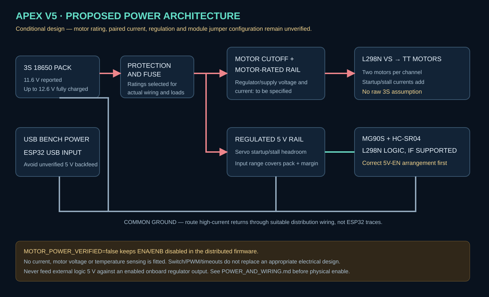

# Electrical verification and exact wiring

## Required sign-off before physical motor output

The owner reports operation at approximately 11.6–12 V. Four TT motors are paired two per L298N channel, and overheating has occurred. No actual motor model, voltage rating, stall current, loaded supply measurements, IR output voltage or regulator-jumper arrangement has been verified here. Operation alone is not proof of electrical suitability.

Keep **MOTOR_POWER_VERIFIED=false** in Config.h and keep motor power disconnected for initial bench work. Bench mode is prominent in the UI/OLED; requested commands can be exercised, but applied physical PWM remains zero.

| Required evidence | Value / evidence | Verified by / date |
|---|---|---|
| Motor manufacturer/model and rated voltage | Unknown | Pending |
| Startup/stall current per motor, from reliable specification or suitable safe measurement | Unknown | Pending |
| Two parallel motors' combined current on each channel | Unknown; currents add | Pending |
| Actual motor supply voltage at idle/startup, capacity/current limit | Reported ~11.6 V only | Pending |
| L298N module cooling/current capability at this load | Unknown | Pending |
| 5V-EN regulator configuration and measured logic 5 V | Unknown | Pending |
| Servo regulated 5 V rail capacity/startup voltage | Unknown | Pending |
| IR outputs never exceed ESP32-safe voltage | Unknown | Pending |
| Common grounds, fuse/wiring and accessible motor cutoff | Inspect | Pending |

The user requirement explicitly asks for these details before enabling physical operation. A statement that it already moves does not fill the missing ratings/measurements. After sign-off, change the single gate to true and rebuild; the software cannot verify this sign-off itself. No runtime voltage/current/thermal sensors exist with this pin map.

## Power architecture

A raw 3S pack may reach 12.6 V fully charged and must not directly power typical 3–6 V TT motors through an L298N. The cutoff switch disconnects; it does not regulate voltage or limit current. PWM is a duty command, not overvoltage protection. Do not hide overheating or weak starting with an automatic high-power kick.

Use a motor supply matched to identified motor voltage and the **combined** motor current. If retaining the 3S pack, use an appropriately specified regulated motor-power stage, wiring, fuse, current limiting and handling of motor transients/braking energy. An unverified small buck board is not a completed design. Choose components only after motor/load data is available.

The [ST L298 datasheet](https://www.st.com/resource/en/datasheet/l298.pdf) gives a separate logic supply and substantial load-dependent bridge loss. Its chip ratings are not a guarantee that a particular module can continuously drive two paired stalled motors per channel. At 1 A the specified total bridge drop is typically 1.8 V, up to 3.2 V under the listed conditions. Do not subtract a guessed fixed drop from 12 V to declare low-voltage motors safe. If the selected driver cannot efficiently serve the verified motors, use a suitable lower-loss driver rather than overvolting them.

Use a regulated 5 V servo/sensor/logic rail with adequate MG90S startup/stall headroom. Keep the ESP32 on USB during bench tests. Do not join external 5 V to USB 5 V unless the board's power arrangement supports it. High-current grounds should return to a suitable common distribution point instead of through thin ESP32/breadboard traces.

## L298N connections

Disconnect all power before wiring. The instructions assume a complete module with appropriate supporting components, not a bare IC.

| Module connection | Destination |
|---|---|
| ENA | GPIO25; remove ENA jumper |
| IN1 / IN2 | GPIO26 / GPIO27 |
| IN3 / IN4 | GPIO14 / GPIO12 |
| ENB | GPIO13; remove ENB jumper |
| OUT1 / OUT2 | Physical left motor pair, wired in parallel with matching rotational polarity |
| OUT3 / OUT4 | Physical right motor pair, wired in parallel with matching rotational polarity |
| VS, often marked 12V | Suitable motor supply positive through the physical cutoff/fuse arrangement |
| GND | Motor supply negative and common ESP32/sensor/servo ground |

Each pair must rotate the wheels on that side in the same chassis direction. Verify pairing with all wheels raised only after power sign-off. Do not assume the module's “12V” terminal marking is the required motor voltage.

**ENA/ENB jumpers are separate from 5V-EN.** Read the exact module documentation for its regulator configuration. With a low motor input, its onboard regulator may not supply usable logic 5 V. If the module supports external logic power, disable its onboard regulator using the documented jumper arrangement and provide regulated 5 V to the logic-supply terminal. Never feed an external 5 V source against an enabled onboard regulator output. A photo of the exact module is needed to verify its board-level arrangement.

Add suitable enable pull-downs (for example 10 kΩ if absent) so the driver is disabled during ESP32 reset/startup. Firmware cannot control pins before execution. GPIO12 and GPIO5 are classic ESP32 boot-strapping pins; external circuitry must not force unsuitable boot levels. Retain the requested pins and diagnose any boot conflict before powering motors.

## Sensor/display connections

| Device | Connection / condition |
|---|---|
| SH1106 SDA / SCL | GPIO21 / GPIO22; 3.3 V-compatible I2C pull-ups |
| MG90S signal | GPIO18 |
| MG90S power | Suitable regulated 5 V, common ground; never ESP32 3.3 V or raw 3S |
| HC-SR04 TRIG | GPIO5 |
| HC-SR04 ECHO | GPIO19 through the existing 5 V-to-3.3 V divider |
| Standard HC-SR04 VCC | 5 V, common ground |
| Left / right IR digital OUT | GPIO34 / GPIO35, verified 3.3 V-safe levels |

Example ECHO divider: ECHO → 2.2 kΩ → GPIO19 node → 3.3 kΩ → GND, approximately 3 V at the node for a 5 V echo. Preserve an existing suitable divider. Standard ESP32 inputs are not 5 V tolerant.

GPIO34/35 are input-only with no internal pull-ups/pull-downs; V5 uses INPUT. IR modules with output pull-ups to 5 V need suitable conditioning or a verified compatible supply/output arrangement. Do not assume a 5 V-powered IR board has a 3.3 V-safe digital OUT. Floating/stuck outputs cannot always be detected from logic levels alone. See the [ESP32 datasheet](https://www.espressif.com/sites/default/files/documentation/esp32_datasheet_en.pdf).

## Measurements and stop conditions

Record voltage at the driver motor input and logic supply under brief load using appropriate equipment. Check connection integrity, wheel/gearbox drag and temperature behavior. Do not intentionally stall motors to discover a rating, and never place a current meter directly across a battery. If unfamiliar with current measurement or battery protection, obtain qualified hands-on help before powering this stage.

Disconnect power if motors/driver/wires/battery heat rapidly, a wheel stalls, or the ESP32 resets. Record failures rather than compensating with more voltage or duty. No completed electrical sign-off is claimed in this package.
